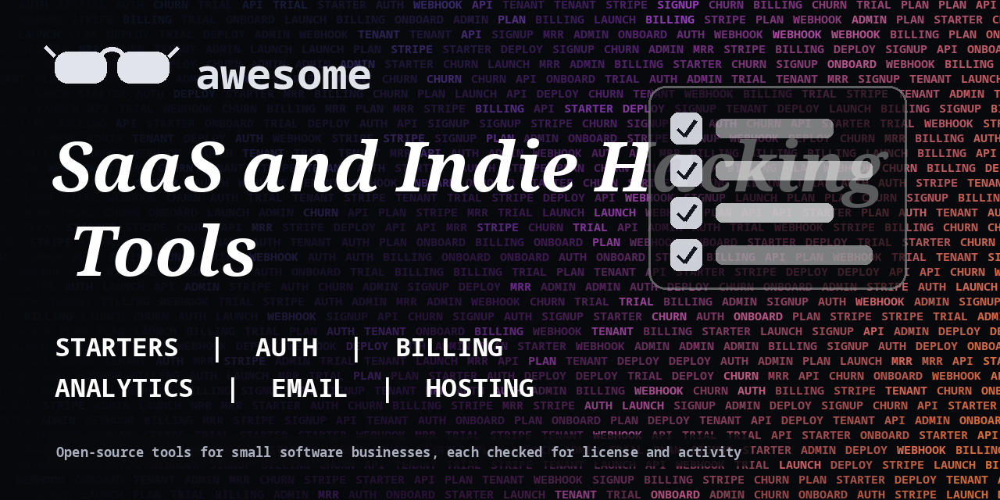

<h1 align="center">Awesome SaaS and Indie Hacking Tools</h1>

> Open-source starters, billing, auth, analytics, email, hosting and admin tools for building and running a small software business. Every entry shows its license.

**Rules of this list:** every repo exists, is public, is not archived, states a license and has had a commit in the last year. One plain sentence each. Star counts and claims are the authors' own, we did not test every tool. Checked 2026-10-18. See [CONTRIBUTING.md](CONTRIBUTING.md).

## Contents

- [SaaS starters and boilerplates](#saas-starters-and-boilerplates)
- [Authentication and users](#authentication-and-users)
- [Billing and subscriptions](#billing-and-subscriptions)
- [Transactional email and notifications](#transactional-email-and-notifications)
- [Product analytics and feedback](#product-analytics-and-feedback)
- [Hosting and deployment](#hosting-and-deployment)
- [Admin panels and internal tools](#admin-panels-and-internal-tools)
- [Backend as a service](#backend-as-a-service)
- [Docs, changelog and status](#docs-changelog-and-status)
- [How to choose](#how-to-choose)
- [Contributing](#contributing)

## SaaS starters and boilerplates

Templates with auth, billing and a dashboard.

- [apptension/saas-boilerplate](https://github.com/apptension/saas-boilerplate)  - Boilerplate for building SaaS apps with Django, React and AWS. _(MIT)_
- [boxyhq/saas-starter-kit](https://github.com/boxyhq/saas-starter-kit)  - Enterprise-ready SaaS starter kit with teams, SSO and billing. _(Apache-2.0)_
- [ixartz/SaaS-Boilerplate](https://github.com/ixartz/SaaS-Boilerplate)  - Next.js SaaS boilerplate with auth, multi-tenancy and billing. _(MIT)_
- [nextjs/saas-starter](https://github.com/nextjs/saas-starter)  - Official Next.js starter with Stripe and auth. _(MIT)_
- [nextjs/saas-starter](https://github.com/nextjs/saas-starter)  - Next.js SaaS starter with Stripe payments and a dashboard. _(MIT)_
- [wasp-lang/open-saas](https://github.com/wasp-lang/open-saas)  - Free, open-source SaaS template built on Wasp, React and Node. _(MIT)_

## Authentication and users

Sign-in, teams and permissions.

- [authelia/authelia](https://github.com/authelia/authelia)  - Single sign-on and two-factor portal for web apps. _(Apache-2.0)_
- [better-auth/better-auth](https://github.com/better-auth/better-auth)  - Authentication framework for TypeScript. _(MIT)_
- [casdoor/casdoor](https://github.com/casdoor/casdoor)  - Identity and access management with SSO and OAuth. _(Apache-2.0)_
- [goauthentik/authentik](https://github.com/goauthentik/authentik)  - Open-source identity provider. _(check repo)_
- [keycloak/keycloak](https://github.com/keycloak/keycloak)  - Open-source identity and access management. _(Apache-2.0)_
- [lucia-auth/lucia](https://github.com/lucia-auth/lucia)  - Resources for implementing your own auth. _(MIT)_
- [nextauthjs/next-auth](https://github.com/nextauthjs/next-auth)  - Authentication for the web, now Auth.js. _(ISC)_
- [ory/kratos](https://github.com/ory/kratos)  - Cloud-native identity and user management. _(Apache-2.0)_
- [supertokens/supertokens-core](https://github.com/supertokens/supertokens-core)  - Open-source authentication with session management. _(check repo)_
- [zitadel/zitadel](https://github.com/zitadel/zitadel)  - Identity infrastructure for apps with multi-tenancy. _(AGPL-3.0)_

## Billing and subscriptions

Plans, usage and invoices.

- [getlago/lago](https://github.com/getlago/lago)  - Open-source usage-based billing and metering. _(AGPL-3.0)_
- [juspay/hyperswitch](https://github.com/juspay/hyperswitch)  - Open-source payments switch that routes across processors. _(Apache-2.0)_
- [killbill/killbill](https://github.com/killbill/killbill)  - Open-source subscription billing and payments platform. _(Apache-2.0)_
- [polarsource/polar](https://github.com/polarsource/polar)  - Open-source platform for monetizing software. _(Apache-2.0)_
- [stripe/stripe-node](https://github.com/stripe/stripe-node)  - Official Stripe library for Node.js. _(MIT)_

## Transactional email and notifications

Send product emails and alerts.

- [knadh/listmonk](https://github.com/knadh/listmonk)  - Self-hosted newsletter and mailing list manager. _(AGPL-3.0)_
- [mjmlio/mjml](https://github.com/mjmlio/mjml)  - Markup language that makes responsive email easy. _(MIT)_
- [novuhq/novu](https://github.com/novuhq/novu)  - Open-source notification infrastructure for email, SMS, push and in-app. _(check repo)_
- [postalserver/postal](https://github.com/postalserver/postal)  - Open-source mail delivery platform. _(MIT)_
- [resend/react-email](https://github.com/resend/react-email)  - Build and send emails with React. _(MIT)_
- [usesend/useSend](https://github.com/usesend/useSend)  - Open-source alternative to Resend and SendGrid. _(AGPL-3.0)_

## Product analytics and feedback

Know what users do.

- [growthbook/growthbook](https://github.com/growthbook/growthbook)  - Feature flags and A/B testing. _(check repo)_
- [openreplay/openreplay](https://github.com/openreplay/openreplay)  - Session replay and product analytics you can self-host. _(check repo)_
- [plausible/analytics](https://github.com/plausible/analytics)  - Simple, privacy-friendly web analytics. _(AGPL-3.0)_
- [PostHog/posthog](https://github.com/PostHog/posthog)  - Product analytics, session replay, feature flags and experiments. _(check repo)_
- [umami-software/umami](https://github.com/umami-software/umami)  - Privacy-focused web analytics. _(MIT)_
- [Unleash/unleash](https://github.com/Unleash/unleash)  - Open-source feature management platform. _(AGPL-3.0)_

## Hosting and deployment

Run your app without a big cloud bill.

- [caddyserver/caddy](https://github.com/caddyserver/caddy)  - Fast web server with automatic HTTPS. _(Apache-2.0)_
- [caprover/caprover](https://github.com/caprover/caprover)  - Scalable PaaS that runs on your own server. _(check repo)_
- [coollabsio/coolify](https://github.com/coollabsio/coolify)  - Self-hostable alternative to Heroku and Vercel. _(Apache-2.0)_
- [dokku/dokku](https://github.com/dokku/dokku)  - Docker-powered mini Heroku you can run yourself. _(MIT)_
- [Dokploy/dokploy](https://github.com/Dokploy/dokploy)  - Self-hostable alternative to Vercel, Netlify and Heroku. _(check repo)_
- [portainer/portainer](https://github.com/portainer/portainer)  - Web UI to manage Docker and Kubernetes. _(Zlib)_
- [traefik/traefik](https://github.com/traefik/traefik)  - Cloud-native reverse proxy and load balancer. _(MIT)_

## Admin panels and internal tools

Back offices without writing everything.

- [appsmithorg/appsmith](https://github.com/appsmithorg/appsmith)  - Platform to build admin panels and internal tools. _(Apache-2.0)_
- [baserow/baserow](https://github.com/baserow/baserow)  - Open-source no-code database and Airtable alternative. _(check repo)_
- [Budibase/budibase](https://github.com/Budibase/budibase)  - Low-code platform for internal apps. _(check repo)_
- [nocodb/nocodb](https://github.com/nocodb/nocodb)  - Open-source Airtable alternative that turns databases into spreadsheets. _(check repo)_
- [refinedev/refine](https://github.com/refinedev/refine)  - React framework for building admin panels and internal tools. _(MIT)_
- [ToolJet/ToolJet](https://github.com/ToolJet/ToolJet)  - Low-code platform for internal tools. _(AGPL-3.0)_

## Backend as a service

Database, API and storage in one.

- [appwrite/appwrite](https://github.com/appwrite/appwrite)  - Backend platform for web and mobile apps. _(BSD-3-Clause)_
- [directus/directus](https://github.com/directus/directus)  - Data platform and headless CMS for any SQL database. _(check repo)_
- [hasura/graphql-engine](https://github.com/hasura/graphql-engine)  - Instant GraphQL APIs on your data. _(Apache-2.0)_
- [nhost/nhost](https://github.com/nhost/nhost)  - Open-source backend with Postgres, GraphQL and auth. _(MIT)_
- [pocketbase/pocketbase](https://github.com/pocketbase/pocketbase)  - Open-source backend in one file, with a database and auth. _(MIT)_
- [supabase/supabase](https://github.com/supabase/supabase)  - Open-source Postgres development platform, an alternative to Firebase. _(Apache-2.0)_

## Docs, changelog and status

Public pages that build trust.

- [facebook/docusaurus](https://github.com/facebook/docusaurus)  - Build optimized documentation websites with React. _(MIT)_
- [louislam/uptime-kuma](https://github.com/louislam/uptime-kuma)  - Self-hosted uptime monitoring tool. _(MIT)_
- [upptime/upptime](https://github.com/upptime/upptime)  - Uptime monitor and status page powered by GitHub Actions. _(MIT)_

## How to choose

- **Buy before you build** for auth and billing when you can.
- **Check the license.** Some tools are source-available with limits for hosting as a service.
- **Own your data.**
- **Ship the smallest version** and talk to users.

## Contributing

See [CONTRIBUTING.md](CONTRIBUTING.md). One entry per pull request, plain words, real sources only.

## About

Maintained by [@devanasolver](https://github.com/devanasolver). Listings follow the rules in CONTRIBUTING.

## Sponsor me

If this list is useful, [buy me a coffee](https://buymeacoffee.com/isaac49).
